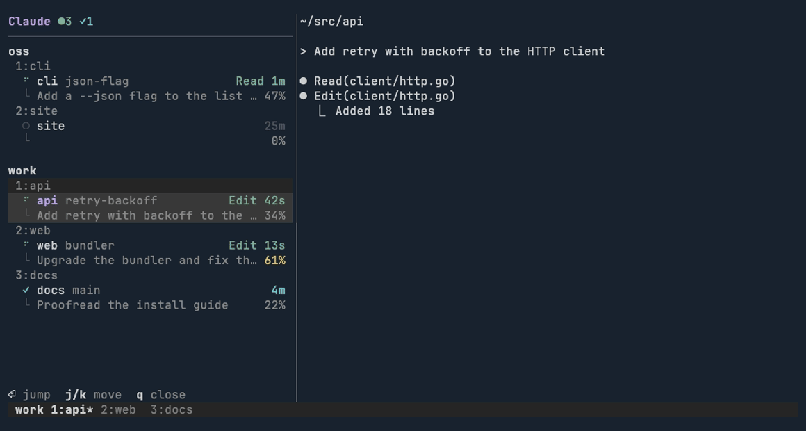
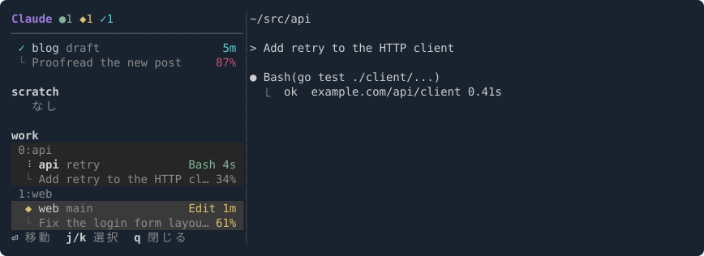

# claude-tmux-sidebar

[English](README.md) | [日本語](README.ja.md)

tmux で Claude Code を何本も並行して動かしていると、どれが承認待ちで、どれがもう終わったのか、すぐに見失います。claude-tmux-sidebar は tmux の全ウィンドウの左側にサイドバーを出し、全 tmux セッションとその中で動いている [Claude Code](https://claude.com/claude-code) セッションを、状態つきでリアルタイムに一覧表示します。



- どの Claude が作業中か、承認待ちか、終わったかが一目で分かります。
- `Enter` かクリックでそのセッションへ移動できます。`prefix + C-n` なら、完了・承認待ちの次の Claude へ直接飛べます。
- Claude が動いていない tmux セッションも表示するので、セッション切り替えにも使えます。

## クイックスタート

1. [TPM](https://github.com/tmux-plugins/tpm) を使う場合、`~/.tmux.conf` に次の行を追記して `prefix + I` を押します:

   ```tmux
   set -g @plugin 'torikatsupg/claude-tmux-sidebar#v0.12.1'
   ```

2. Claude Code の中で hook を入れ、起動済みの Claude Code を再起動します:

   ```
   /plugin install tmux-sidebar --marketplace torikatsupg/claude-tmux-sidebar
   ```

`prefix + b` でサイドバーが開きます。ほかの入れ方は [インストール](#インストール) を参照してください。

## 状態表示



| 表示 | 状態 | どんなとき |
|---|---|---|
| ⠹ (緑) | 稼働中 | Claude が作業中、またはバックグラウンドで起動したサブエージェント・shell がまだ動いている |
| ◆ (黄) | 承認待ち・質問待ち | Claude が承認を求めている、または質問している |
| ✓ (水色) | 完了 | ターンが終わり、動いているものが残っていない |
| ○ (灰) | 待機 | 起動直後、または 60 秒入力がない |

各セッションにはディレクトリと git ブランチを表示し、右側に使用中のツールとその状態になってからの経過時間を表示します。下の行には最後に送ったプロンプトと context window の使用率を表示します（50% から黄色、80% から赤）。ウィンドウ番号（`1:api`）は、その tmux セッションにウィンドウが 2 つ以上あるときだけ付きます。今いるウィンドウの行は、背景を少し明るくして示します。その行にカーソルがあるときは、代わりにウィンドウ番号をアクセントの色で出します。

## 操作

| キー | 動作 |
|---|---|
| `prefix + b` | サイドバーを開いてフォーカス（全ウィンドウ）。開いていればフォーカス、フォーカス中なら閉じる |
| `prefix + B` | ポップアップで一覧（選択するとジャンプして閉じる） |
| `prefix + C-n` / `prefix + C-p` | 次 / 前の完了・承認待ちの Claude へ移動 |
| `j` / `k` / `g` / `G` | 選択移動 |
| `n` / `p` | 次 / 前の完了・承認待ちの Claude を選択 |
| `Enter` / クリック | そのペイン（ウィンドウ行ならそのウィンドウ、セッション行ならその tmux セッション）へ移動 |
| `q` | 閉じる |

セッション・ウィンドウ・ペインは tmux と同じ順に並びます。選択行は今フォーカスしているペインに追従します。

## 設定

`~/.tmux.conf` の、プラグインを読み込む行（`run '~/.tmux/plugins/tpm/tpm'`）より**前**に書きます。

```tmux
set -g @cts_width 34          # サイドバー幅
set -g @cts_toggle_key b      # 複数指定可（空白区切り）
set -g @cts_popup_key B
set -g @cts_next_key C-n
set -g @cts_prev_key C-p
set -g @cts_default off       # tmux 起動時に開いておくか
set -g @cts_lang ja           # en / ja
set -g @cts_help on           # 下端のキー操作ヘルプを表示
set -g @cts_label auto        # 行の並べ方: auto（セッション > ウィンドウ > Claude）/ dir（平ら）/ window（#I:#W）
set -g @cts_single_window inline  # auto のとき、セッションに 1 つだけの名前付きウィンドウ: inline / lines
set -g @cts_all_windows off   # Claude のいないウィンドウも一覧に出す
set -g @cts_indent 1          # 階層ごとの字下げ（空白の数）: 0〜4
set -g @cts_notify off        # 承認待ち・完了になったときの通知: off / tmux / os / all
set -g @cts_hook_index 77     # tmux hook 配列のインデックス（衝突時のみ変更）
set -g @cts_color_accent '#D97757'  # 色（下の表を参照）
set -g @cts_color_active colour235  # 今いるウィンドウの行の背景
set -g @cts_context_windows 'claude-opus-5-5=1000000'  # モデルごとの context window のサイズ
```

tmux が既に割り当てているキー（例: `C-b` は `send-prefix`）を指定すると、プラグイン側の割り当てで上書きされます。

`@cts_label window` にすると、各行にはディレクトリとブランチの代わりに tmux のウィンドウを `番号:名前` で出します。ウィンドウ名を変えれば、次の更新で新しい名前になります。tmux の外で動いているセッションはディレクトリのままです。

既定（`@cts_label auto`）では、一覧はセッション、ウィンドウ、Claude の行の階層になり、各行は親の 1 段下にディレクトリとブランチを出します。複数のウィンドウがあるセッションでは、各ウィンドウが見出しになります。自分で名前を付けたウィンドウは `番号:名前`、それ以外は `番号` だけです。tmux はウィンドウに実行中のコマンドの名前を付けるので、Claude Code のウィンドウはバージョン番号になるためです。`automatic-rename` が off のウィンドウを、名前を付けたものとして扱います。`rename-window` や `new-window -n` で名前を付けると off になります。以前の平らな一覧に戻すには `@cts_label dir` にしてください。複数ウィンドウのセッションでは、各行にウィンドウ番号が付きます。

ウィンドウが 1 つだけのセッションでは、ウィンドウの見出しを出さず、行をセッションの下に置きます。ウィンドウに名前を付けていれば、セッションの見出しは `セッション/名前` になります。`@cts_single_window lines` にすると、名前付きのウィンドウには別の行の見出しを付けます。

`@cts_all_windows on` にすると、tmux のウィンドウをすべて tmux と同じ順に並べます。Claude のいないウィンドウは `番号:名前` の薄い行になり、`Enter` かクリックでそのウィンドウへ移動します。カーソルはこの行にも止まりますが、`n` / `p` と `prefix + C-n` / `prefix + C-p` では飛ばします。どれかのペインで Claude が動いているウィンドウは、Claude の行だけを出します。`link-window` で複数のセッションに入っているウィンドウは、そのうち tmux の順で最後のセッションの下に 1 回だけ出します。Claude の行も同じ扱いです。この設定はサイドバーを開くときに読みます。

色は役割ごとに別の設定で、tmux の色の書き方のうち次のものを使えます。色名（`black` `red` `green` `yellow` `blue` `magenta` `cyan` `white` と、`brightred` のような `bright` 付き、`default`）、`colour0`〜`colour255`（`color0`〜`color255` も可）、`#rrggbb` のどれかです。未設定や読めない値なら既定の色のままです。`coral` や `grey50` のような tmux の他の色名も読めないので、`#rrggbb` で書いてください。サイドバーは開くときに読むので、変えたら開き直してください。

| 設定 | 色を付ける箇所 | 既定値 |
|---|---|---|
| `@cts_color_accent` | タイトルと、今いるウィンドウのカーソル行にあるウィンドウ番号 | `magenta` |
| `@cts_color_cursor` | カーソル行の背景 | `colour237` |
| `@cts_color_active` | 今いるウィンドウの行の背景 | `colour235` |
| `@cts_color_muted` | 補足の文字（ブランチ、プロンプト、ヘルプの説明） | `colour245` |
| `@cts_color_dim` | 薄い文字（区切り線、待機の印） | `brightblack` |
| `@cts_color_waiting` | 承認待ちの印（`cts status --color` でも使う） | `yellow` |
| `@cts_color_running` | 稼働中の印（`cts status --color` でも使う） | `green` |
| `@cts_color_done` | 完了の印（`cts status --color` でも使う） | `cyan` |
| `@cts_color_warning` | context window の使用率（50% から） | `yellow` |
| `@cts_color_critical` | context window の使用率（80% から） | `red` |

`@cts_context_windows` には `モデル=トークン数` の組を空白区切りで書きます。モデルは Claude Code が transcript に書く ID（`claude-opus-5-5` など）です。設定しないとき、または設定にないモデルは、[Claude Code の公式のルール](https://code.claude.com/docs/en/model-config#extended-context)でサイズを判定します。Fable、Mythos、Opus 4.7 以降、Sonnet 5 以降、Haiku 5.5 以降のモデル、名前が `[1m]` で終わるモデル、200k トークンを超えて使っているときは 1M、それ以外は 200k です。`CLAUDE_CODE_DISABLE_1M_CONTEXT=1` を使っているときなど、この判定が外れる場合だけモデルを書いてください。モデルのサイズは、`claude -p --model <モデル> --output-format json "hi"` を実行して `modelUsage.<モデル ID>.contextWindow` を見れば分かります。

サイズは Claude Code に教えてもらうこともできます。[status line](https://code.claude.com/docs/en/statusline) の入力にはセッションごとの実際のサイズが入っていて、これは `@cts_context_windows` と上の判定より優先されます。任意の設定で、判定が外れるときだけ役に立ちます。status line のスクリプトで入力を読んだあとに 1 行足して、Claude を起動し直してください。

```bash
input=$(cat)
echo "$input" | ~/.tmux/plugins/claude-tmux-sidebar/bin/cts statusline
```

このコマンドは何も出力しないので、status line の表示は変わりません。

## status line と通知

サイドバーを閉じていても、別のウィンドウにいても、手が必要なセッションに気づけます。`cts status` は承認待ち・稼働中・完了の Claude の数を `◆2 ⠹1 ✓3` のように出します。0 件の状態は出さず、どれも 0 なら何も出しません。`status-right` に書いて使います。

```tmux
set -g status-right '#(~/.tmux/plugins/claude-tmux-sidebar/bin/cts status) %H:%M'
set -g status-interval 5   # tmux が実行し直す間隔（秒、既定は 15）
```

色を付けるなら tmux のスタイルで囲むか、`--color` を付けます。`--color` では件数ごとに `@cts_color_waiting`・`@cts_color_running`・`@cts_color_done` の色が付きます（既定は黄・緑・シアン）。色を付けた件数の後ろには `#[fg=default]` が入ります。書ける色はサイドバーと同じで、読めない値なら既定の色になります。

```tmux
set -g status-right '#[fg=yellow]#(~/.tmux/plugins/claude-tmux-sidebar/bin/cts status)#[default] %H:%M'
set -g status-right '#(~/.tmux/plugins/claude-tmux-sidebar/bin/cts status --color) %H:%M'
```

`@cts_notify` を設定すると、セッションが承認待ちや完了になったときに知らせます。

| 値 | 通知 |
|---|---|
| `off`（既定） | なし |
| `tmux` | 使っているクライアントに `◆ api:2 承認待ち` のように表示し（tmux セッション名、ウィンドウが複数あればその番号、状態）、そのセッションのウィンドウでベルを鳴らす |
| `os` | デスクトップ通知。macOS は `osascript`、Linux は `notify-send` を使い、コマンドが無ければ何もしない |
| `all` | 両方 |

最後に使ったクライアントにそのセッションのウィンドウが映っているときは知らせません。ただし、そのウィンドウで別のペインをズームしているときは知らせます。もともと同じ状態だったセッションも知らせません。Claude Code の承認の通知はプロンプトが出てから 6 秒ほどで届くので、答えたあとに届くことがあります。直前の hook から 5 秒以内に届いたものでは知らせません。通知するのは tmux の中で動いているセッションだけです。

hook は tmux を待たずに済むよう、プラグインが tmux の読み込み時に書く `~/.cache/claude-tmux-sidebar/notify` から設定を読みます。`@cts_notify` を変えたら `tmux source ~/.tmux.conf` で設定を読み込み直してください。

## 必要なもの

- tmux 3.2+
- Claude Code
- macOS または Linux（arm64 / x86_64）。ビルド済みバイナリのダウンロードに `curl`、または自前でビルドするなら [Rust ツールチェーン](https://rustup.rs)
- `jq`（`install.sh` を使う場合のみ）

初回の起動時に、対応する GitHub Release から自分の環境向けのバイナリをダウンロードし、SHA-256 を検証します。合うバイナリが無ければ `cargo` でビルドします。リリースのバイナリには [build provenance attestation](https://docs.github.com/ja/actions/security-for-github-actions/using-artifact-attestations) が付いていて、次で確認できます:

```sh
gh attestation verify ~/.tmux/plugins/claude-tmux-sidebar/bin/claude-tmux-sidebar --repo torikatsupg/claude-tmux-sidebar
```

## インストール

サイドバーを描く **tmux プラグイン** と、各セッションの状態を書き出す **Claude Code の hook** の 2 つを入れます。[クイックスタート](#クイックスタート) で両方入ります。それ以外の入れ方:

- **リリースではなく `main` を追う**: `set -g @plugin 'torikatsupg/claude-tmux-sidebar'`。タグでの固定をおすすめします。タグを書き換えるまで何も変わらず、リリースのタグは移動も削除もできません。
- **Claude Code プラグインをリリースに固定する**: `/plugin marketplace add torikatsupg/claude-tmux-sidebar#v0.12.1` のあと `/plugin install tmux-sidebar@torikatsupg`。タグを付けずに同じ 2 行を実行すれば、`--marketplace` の無い古い Claude Code でも入ります。
- **Claude Code プラグインを使わずに hook を入れる**: `~/.tmux/plugins/claude-tmux-sidebar/install.sh --hooks-only` で `~/.claude/settings.json` に登録します（実行前にバックアップ `settings.json.bak.<日時>` を作成）。プラグインと両方入れると hook が 2 回ずつ走るので、どちらか一方にしてください。
- **TPM を使わない**:

  ```sh
  git clone --branch v0.12.1 https://github.com/torikatsupg/claude-tmux-sidebar ~/.tmux/plugins/claude-tmux-sidebar
  ~/.tmux/plugins/claude-tmux-sidebar/install.sh
  ```

  hook を登録し、`~/.tmux.conf` に `run-shell '.../sidebar.tmux'` を追記します（tmux の中で実行した場合はその場で読み込みます）。

起動済みの Claude Code は再起動すると hook が有効になります。

### アンインストール

- TPM: `@plugin` 行を消して `prefix + alt + u`
- Claude Code プラグイン: `/plugin uninstall tmux-sidebar@torikatsupg`
- `install.sh`: `./install.sh --uninstall`

## プライバシー

データは手元のマシンから出ません。各 Claude セッションの状態は `~/.cache/claude-tmux-sidebar/<session_id>.json` に本人だけが読める権限で保存され、セッションが終わると消えます。中身はセッション ID・作業ディレクトリ・ツール名・tmux ペイン・Claude のプロセス ID・セッションの transcript のパス・最後のプロンプトの先頭 200 文字です。git ブランチと context の使用率はサイドバーがその transcript の末尾から読み取り、保存はしません。

デバッグ用に `CTS_DEBUG=1` を付けて Claude を起動すると、hook の生 payload が `~/.cache/claude-tmux-sidebar/debug.log` に残ります。**このログにはプロンプトやツールの入力がそのまま入る**ので、使い終わったら消し、共有する前に中身を確認してください。

## 制約

- Esc で中断したターンや、承認を拒否して止まったターンは、60 秒後に「待機」に戻るまで「稼働中」か「承認待ち」のままです。
- zoom 中のウィンドウにはサイドバーを足しません（zoom が解除されてしまうため）。次に訪れたときに足します。

## 開発に参加する

仕組み・開発環境・リリース手順は [CONTRIBUTING.md](CONTRIBUTING.md)（英語）にまとめています。

## ライセンス

[MIT](LICENSE)
