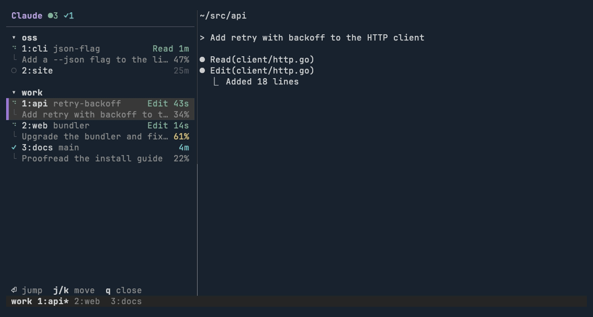
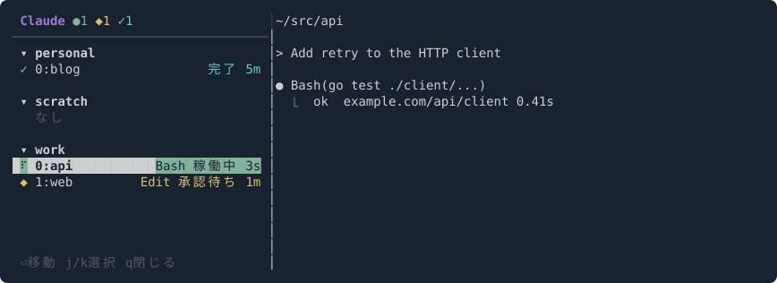

# claude-tmux-sidebar

[English](README.md) | [日本語](README.ja.md)

tmux で Claude Code を何本も並行して動かしていると、どれが承認待ちで、どれがもう終わったのか、すぐに見失います。claude-tmux-sidebar は tmux の全ウィンドウの左側にサイドバーを出し、全 tmux セッションとその中で動いている [Claude Code](https://claude.com/claude-code) セッションを、状態つきでリアルタイムに一覧表示します。



- どの Claude が作業中か、承認待ちか、終わったかが一目で分かります。
- `Enter` かクリックでそのセッションへ移動できます。`prefix + C-n` なら、完了・承認待ちの次の Claude へ直接飛べます。
- Claude が動いていない tmux セッションも表示するので、セッション切り替えにも使えます。

## クイックスタート

1. [TPM](https://github.com/tmux-plugins/tpm) を使う場合、`~/.tmux.conf` に次の行を追記して `prefix + I` を押します:

   ```tmux
   set -g @plugin 'torikatsupg/claude-tmux-sidebar#v0.6.0'
   ```

2. Claude Code の中で hook を入れ、起動済みの Claude Code を再起動します:

   ```
   /plugin install tmux-sidebar --marketplace torikatsupg/claude-tmux-sidebar
   ```

`prefix + b` でサイドバーが開きます。TPM を使わない入れ方、古い Claude Code での手順、Claude Code プラグインを使わない hook の登録、アンインストールは [必要なもの](#必要なもの) と [インストール](#インストール) を参照してください。

## 状態表示



| 表示 | 状態 | 元になる Claude Code hook |
|---|---|---|
| ⠹ (緑) | 稼働中 | `UserPromptSubmit` / `PreToolUse` / `PostToolUse` |
| ◆ (黄) | 承認待ち・質問待ち | `PermissionRequest` / `Notification(permission_prompt)` / `PreToolUse(AskUserQuestion)` |
| ✓ (水色) | 完了 | `Stop` |
| ○ (灰) | 待機 | `SessionStart`、60 秒放置 (`Notification(idle_prompt)`) |

各セッションにはディレクトリと git ブランチを表示し、右側に使用中のツールとその状態になってからの経過時間を表示します。下の行には最後に送ったプロンプトと context window の使用率を表示します（50% から黄色、80% から赤）。ウィンドウ番号（`1:api`）は、その tmux セッションにウィンドウが 2 つ以上あるときだけ付きます。左端のマゼンタのバーは、今いるウィンドウの印です。

## 必要なもの

- tmux 3.2+
- Claude Code
- macOS または Linux（arm64 / x86_64）。ビルド済みバイナリのダウンロードに `curl`、または自前でビルドするなら [Rust ツールチェーン](https://rustup.rs)
- `jq`（`install.sh` を使う場合のみ）

本体は Rust の単一バイナリです。tmux プラグインか Claude Code の hook が初めて動いたときに、`scripts/fetch-binary.sh` が対応する GitHub Release から自分の環境向けのバイナリを `bin/` にダウンロードします（SHA-256 を検証）。合うバイナリが無ければ `cargo` でビルドします。バイナリが揃うまでに届いた hook イベントは読み飛ばします。

v0.2.0 より後のリリースのバイナリには [build provenance attestation](https://docs.github.com/ja/actions/security-for-github-actions/using-artifact-attestations) が付きます。ダウンロードしたバイナリがこのリポジトリのリリース workflow でビルドされたものかは次で確認できます:

```sh
gh attestation verify ~/.tmux/plugins/claude-tmux-sidebar/bin/claude-tmux-sidebar --repo torikatsupg/claude-tmux-sidebar
```

## インストール

サイドバーを描く **tmux プラグイン** と、各セッションの状態を書き出す **Claude Code の hook** の 2 つを入れます。

### 1. tmux プラグイン

[TPM](https://github.com/tmux-plugins/tpm) を使う場合、`~/.tmux.conf` に追記して `prefix + I`:

```tmux
set -g @plugin 'torikatsupg/claude-tmux-sidebar'
```

リリースの固定をおすすめします: `set -g @plugin 'torikatsupg/claude-tmux-sidebar#v0.6.0'`。`main` の最新ではなくタグの付いたリリースが動き、タグを書き換えるまで何も変わりません。リリースのタグは移動も削除もできません。

### 2. Claude Code の hook

Claude Code の中で `tmux-sidebar` プラグインを入れます:

```
/plugin install tmux-sidebar --marketplace torikatsupg/claude-tmux-sidebar
```

古い Claude Code の場合:

```
/plugin marketplace add torikatsupg/claude-tmux-sidebar
/plugin install tmux-sidebar@torikatsupg
```

リリースを固定するなら、marketplace をタグ付きで追加します: `/plugin marketplace add torikatsupg/claude-tmux-sidebar#v0.6.0`。

起動済みの Claude Code は再起動すると hook が有効になります。

Claude Code プラグインを使わない場合は、`~/.claude/settings.json` に直接 hook を登録します（実行前にバックアップ `settings.json.bak.<日時>` を作成）:

```sh
~/.tmux/plugins/claude-tmux-sidebar/install.sh --hooks-only
```

両方入れると hook が 2 回ずつ走るので、どちらか一方にしてください。

### TPM を使わない場合

```sh
git clone --branch v0.6.0 https://github.com/torikatsupg/claude-tmux-sidebar ~/.tmux/plugins/claude-tmux-sidebar
~/.tmux/plugins/claude-tmux-sidebar/install.sh
```

hook を登録し、`~/.tmux.conf` に `run-shell '.../sidebar.tmux'` を追記します（tmux の中で実行した場合はその場で読み込みます）。

### アンインストール

- TPM: `@plugin` 行を消して `prefix + alt + u`
- Claude Code プラグイン: `/plugin uninstall tmux-sidebar@torikatsupg`
- `install.sh`: `./install.sh --uninstall`

## 操作

| キー | 動作 |
|---|---|
| `prefix + b` | サイドバーを開いてフォーカス（全ウィンドウ）。開いていればフォーカス、フォーカス中なら閉じる |
| `prefix + B` | ポップアップで一覧（選択するとジャンプして閉じる） |
| `prefix + C-n` / `prefix + C-p` | 次 / 前の完了・承認待ちの Claude へ移動 |
| `j` / `k` / `g` / `G` | 選択移動 |
| `n` / `p` | 次 / 前の完了・承認待ちの Claude を選択 |
| `Enter` / クリック | そのペイン（セッション行ならその tmux セッション）へ移動 |
| `q` | 閉じる |

セッション・ウィンドウ・ペインは tmux と同じ順に並びます。選択行は今フォーカスしているペインに追従します。

## 設定

`~/.tmux.conf` の、プラグインを読み込む行（`run '~/.tmux/plugins/tpm/tpm'`）より**前**に書きます。

```tmux
set -g @cts_width 34          # サイドバー幅
set -g @cts_toggle_key b      # 複数指定可（空白区切り）
set -g @cts_popup_key B
set -g @cts_next_key C-n
set -g @cts_prev_key C-p
set -g @cts_default off       # tmux 起動時に開いておくか
set -g @cts_lang ja           # en / ja
set -g @cts_help on           # 下端のキー操作ヘルプを表示
set -g @cts_hook_index 77     # tmux hook 配列のインデックス（衝突時のみ変更）
```

tmux が既に割り当てているキー（例: `C-b` は `send-prefix`）を指定すると、プラグイン側の割り当てで上書きされます。

## 仕組み

すべて 1 つのバイナリ `claude-tmux-sidebar` が担い、`bin/cts` と `bin/cts-hook` はその入口の小さなシェルスクリプトです。

- `claude-tmux-sidebar hook`: Claude Code の各 hook から呼ばれ、`~/.cache/claude-tmux-sidebar/<session_id>.json` に状態・`$TMUX_PANE`・Claude の PID を書きます。`SessionEnd` で削除します。
- `claude-tmux-sidebar toggle` / `ensure` / `fix-width` など: tmux 側の制御。`after-new-window` などの tmux hook でウィンドウ左端に全高ペインを足し、レイアウト変更時は幅を戻します。サイドバーを閉じると、開く前のレイアウトに戻します。
- `claude-tmux-sidebar sidebar`: 一覧の描画。ペインが消えた・プロセスが死んだセッションの状態ファイルは掃除します。サイドバーしか残っていないウィンドウでは自分を閉じます。

## プライバシー

データは手元のマシンから出ません。状態ファイルにはセッション ID・作業ディレクトリ・ツール名・tmux ペイン・git ブランチ・context の使用率・最後のプロンプトの先頭 200 文字が入り、本人だけが読める権限で作られます。git ブランチと context の使用率は、セッションの transcript の末尾から読み取ります。

デバッグ用に `CTS_DEBUG=1` を付けて Claude を起動すると、hook の生 payload が `~/.cache/claude-tmux-sidebar/debug.log` に残ります。**このログにはプロンプトやツールの入力がそのまま入る**ので、使い終わったら消し、共有する前に中身を確認してください。

## 制約

- Esc で中断したターンは `Stop` が飛ばないため、60 秒後の `idle_prompt` で「待機」に戻るまで「稼働中」のままです。
- zoom 中のウィンドウにはサイドバーを足しません（zoom が解除されてしまうため）。次に訪れたときに足します。

## 開発

Rust ツールチェーン（バージョンは `rust-toolchain.toml` で固定）、[shellcheck](https://www.shellcheck.net)、[shfmt](https://github.com/mvdan/sh) が必要です。

```sh
cargo xtask ci                 # rustfmt・clippy・テスト・shellcheck・shfmt・モジュールサイズ上限（CI と同じ）
scripts/fetch-binary.sh --build  # 手元の tmux で試すために、このチェックアウトから bin/claude-tmux-sidebar をビルド
scripts/screenshot.sh          # docs/screenshot.svg を再生成（日本語版は scripts/screenshot.sh ja）
```

コードの構成（`src/`）: 純粋なモジュールは値から値を作るだけにし、副作用は端に寄せています。

| モジュール | 役割 |
|---|---|
| `cli`・`lib`・`main` | 引数の解析と振り分け |
| `tmux`・`session::store`・`process` | 副作用: tmux サーバー・状態ファイル・他プロセス |
| `hook` | hook の payload → 状態遷移（`transition` は純粋な状態機械） |
| `control` | サイドバーの開閉とレイアウトの復元 |
| `sidebar` | 一覧 UI。`update` は純粋な `(model, msg) → (model, effects)`、`view` が描画、`effect` が副作用を実行 |
| `listing`・`jump` | tmux 順のグループ化、完了・承認待ちセッションへの移動 |

スタイルのルールは clippy（`Cargo.toml` の `[workspace.lints]` と `clippy.toml`）と `cargo xtask ci` で強制しています: `unwrap` / `expect` / `panic` / 添字アクセス / `as` キャストの禁止、関数は 30 行まで、モジュールは 200 行まで、可変のループより `map`・`filter`・`fold` などのイテレータ。

リリースは、`Cargo.toml`・`.claude-plugin/plugin.json`・`.claude-plugin/marketplace.json` の `version` を上げ、`CHANGELOG.md` に節を足して `main` にマージしたあと、Actions タブから **Release** ワークフローを実行します。macOS と Linux（arm64 / x86_64）のバイナリをビルドし、`v<version>` のタグと、それらを添付した GitHub Release を作ります。実行できるのはリポジトリのオーナーだけです。

## ライセンス

[MIT](LICENSE)
