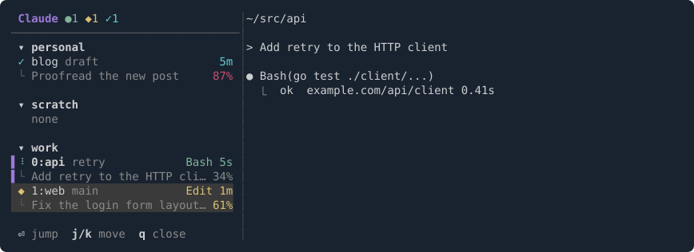

# claude-tmux-sidebar

[English](README.md) | [日本語](README.ja.md)

Run several Claude Code sessions in parallel across tmux and you soon lose track of which one is waiting for your approval and which one has already finished. claude-tmux-sidebar keeps a sidebar on the left of every tmux window that lists all your tmux sessions and the [Claude Code](https://claude.com/claude-code) sessions running in them, with live status.


- See at a glance which Claude is working, which one is waiting for your approval, and which one has finished.
- Jump to any session with `Enter` or a click, or straight to the next Claude that is done or waiting with `prefix + C-n`.
- tmux sessions without Claude are listed too, so the sidebar doubles as a session switcher.

## Quick start

1. With [TPM](https://github.com/tmux-plugins/tpm), add the plugin to `~/.tmux.conf` and press `prefix + I`:

   ```tmux
   set -g @plugin 'torikatsupg/claude-tmux-sidebar#v0.7.0'
   ```

2. Inside Claude Code, install the hooks, then restart running Claude Code sessions:

   ```
   /plugin install tmux-sidebar --marketplace torikatsupg/claude-tmux-sidebar
   ```

Press `prefix + b` to open the sidebar. For other ways to install, see [Install](#install).

## Status



| Icon | Status | When |
|---|---|---|
| ⠹ (green) | running | Claude is working, or subagents, shells or monitors it started in the background still are |
| ◆ (yellow) | waiting for you | Claude asks for approval or asks you a question |
| ✓ (cyan) | done | The turn has ended and nothing is left running |
| ○ (gray) | idle | Just started, or 60 s without input |

Each session shows its directory and git branch, with the tool in use and how long it has been in that status on the right. The line below shows the last prompt you sent and how full the context window is (yellow from 50%, red from 80%). The window index (`1:api`) appears only when the tmux session has more than one window. A magenta bar on the left edge marks the window you are in.

## Usage

| Key | Action |
|---|---|
| `prefix + b` | Open the sidebar (in every window) and focus it; when it is already open, focus it; when it has the focus, close it |
| `prefix + B` | Show the list in a popup (jumps and closes on select) |
| `prefix + C-n` / `prefix + C-p` | Go to the next / previous Claude that is done or waiting for you |
| `j` / `k` / `g` / `G` | Move the selection |
| `n` / `p` | Select the next / previous done or waiting Claude |
| `Enter` / click | Go to that pane (or that tmux session, on a session row) |
| `q` | Close |

Sessions, windows and panes are listed in tmux's own order. The selection follows the pane you are focused on.

## Options

Set them in `~/.tmux.conf` **before** the plugin is loaded (before `run '~/.tmux/plugins/tpm/tpm'`).

```tmux
set -g @cts_width 34          # sidebar width
set -g @cts_toggle_key b      # several keys allowed, space-separated
set -g @cts_popup_key B
set -g @cts_next_key C-n
set -g @cts_prev_key C-p
set -g @cts_default off       # open the sidebar when tmux starts
set -g @cts_lang en           # en / ja
set -g @cts_help on           # show the key help at the bottom
set -g @cts_hook_index 77     # tmux hook array index (change only on conflicts)
```

Avoid keys tmux already binds (e.g. `C-b` is `send-prefix`): the plugin's binding replaces them.

## Requirements

- tmux 3.2+
- Claude Code
- macOS or Linux (arm64 / x86_64), with `curl` to download the prebuilt binary — or a [Rust toolchain](https://rustup.rs) to build it
- `jq`, only for `install.sh`

On first run, the plugin downloads the binary for your platform from the matching GitHub release and checks its SHA-256, or builds it with `cargo` when no release binary fits. Release binaries carry a [build provenance attestation](https://docs.github.com/en/actions/security-for-github-actions/using-artifact-attestations), which you can check with:

```sh
gh attestation verify ~/.tmux/plugins/claude-tmux-sidebar/bin/claude-tmux-sidebar --repo torikatsupg/claude-tmux-sidebar
```

## Install

There are two parts: the **tmux plugin** draws the sidebar, and the **Claude Code hooks** report each session's status. The [Quick start](#quick-start) installs both; for other setups:

- **Follow `main` instead of a release**: `set -g @plugin 'torikatsupg/claude-tmux-sidebar'`. Pinning a tag is recommended: nothing changes until you change the tag, and release tags cannot be moved or deleted.
- **Pin the Claude Code plugin to a release**: `/plugin marketplace add torikatsupg/claude-tmux-sidebar#v0.7.0`, then `/plugin install tmux-sidebar@torikatsupg`. The same two commands without the tag also work on Claude Code versions without `--marketplace`.
- **Hooks without the Claude Code plugin**: `~/.tmux/plugins/claude-tmux-sidebar/install.sh --hooks-only` registers them in `~/.claude/settings.json` (backed up first as `settings.json.bak.<timestamp>`). Use this or the plugin, not both, or every hook runs twice.
- **Without TPM**:

  ```sh
  git clone --branch v0.7.0 https://github.com/torikatsupg/claude-tmux-sidebar ~/.tmux/plugins/claude-tmux-sidebar
  ~/.tmux/plugins/claude-tmux-sidebar/install.sh
  ```

  This registers the hooks and appends `run-shell '.../sidebar.tmux'` to `~/.tmux.conf` (and loads it right away when run inside tmux).

Restart running Claude Code sessions to pick up the hooks.

### Uninstall

- TPM: remove the `@plugin` line and press `prefix + alt + u`.
- Claude Code plugin: `/plugin uninstall tmux-sidebar@torikatsupg`.
- `install.sh`: run `./install.sh --uninstall`.

## Privacy

Everything stays on your machine. Each Claude session's status is kept in `~/.cache/claude-tmux-sidebar/<session_id>.json`, readable only by you and removed when the session ends. It holds the session ID, working directory, tool name, tmux pane, Claude's process ID, git branch, context usage and the first 200 characters of your last prompt. The git branch and context usage are read from the end of the session's transcript.

For debugging, start Claude with `CTS_DEBUG=1` to append raw hook payloads to `~/.cache/claude-tmux-sidebar/debug.log`. **The log contains your prompts and tool inputs** — delete it when done and check it before sharing.

## Limitations

- A turn interrupted with Esc stays "running" until it turns idle 60 seconds later.
- The sidebar is not added to a zoomed window (it would unzoom it); it is added on the next visit.

## Contributing

See [CONTRIBUTING.md](CONTRIBUTING.md) for how it works, the development setup and the release steps.

## License

[MIT](LICENSE)
